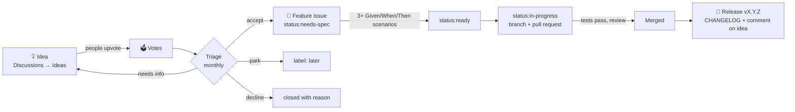

# From idea to feature: how we decide and build

This guide explains, step by step, how an idea for Handball Dansk becomes a
shipped feature: where ideas are written down, how people vote, how an idea is
turned into a feature with several acceptance tests, and how the work is
tracked on GitHub. It is written so that a new maintainer can run the whole
process without help.

- [1. Overview](#1-overview)
- [2. Roles](#2-roles)
- [3. Where everything lives](#3-where-everything-lives)
- [4. Step 1: capture an idea](#4-step-1-capture-an-idea)
- [5. Step 2: vote](#5-step-2-vote)
- [6. Step 3: triage](#6-step-3-triage)
- [7. Step 4: write the feature spec](#7-step-4-write-the-feature-spec)
- [8. Step 5: plan the work](#8-step-5-plan-the-work)
- [9. Step 6: build and review](#9-step-6-build-and-review)
- [10. Step 7: release and close the loop](#10-step-7-release-and-close-the-loop)
- [11. Labels reference](#11-labels-reference)
- [12. Worked example](#12-worked-example)
- [13. Command-line cheat sheet](#13-command-line-cheat-sheet)
- [14. Maintaining the setup](#14-maintaining-the-setup)
- [15. FAQ](#15-faq)

## 1. Overview



Three separate things, each in its own place:

| Thing | Answers | Lives in | Who can create it |
|---|---|---|---|
| **Idea** | *What problem do you have?* | Discussions → **Ideas** | Anyone with a GitHub account |
| **Feature** | *What exactly will we build, and how do we test it?* | Issue (Feature template) | Maintainers, after triage |
| **Change** | *The code that does it* | Pull request | Anyone |

Keeping ideas out of the issue list means issues stay a clean, actionable to-do
list, while ideas can collect votes and discussion for as long as needed.

## 2. Roles

| Role | Who (today) | Responsibilities |
|---|---|---|
| **Maintainer** | Franck (`@fzaire`) | Runs triage, writes or approves feature specs, merges pull requests, publishes releases. |
| **Voters** | Samuel, teammates, coaches, parents | Post ideas, upvote, answer questions on ideas. |
| **Contributors** | Anyone | Pick `status:ready` issues, open pull requests. |
| **Language reviewer** (optional) | A native Danish speaker | Checks new or changed Danish phrases before merge. |

If a second maintainer joins, add them as a repository collaborator
(**Settings → Collaborators**) so they can label, triage and merge.

## 3. Where everything lives

| What | Link |
|---|---|
| Ideas and votes | [Discussions → Ideas](https://github.com/fzaire/danish-english-handball-language/discussions/categories/ideas) |
| Ideas sorted by votes | [Top ideas](https://github.com/fzaire/danish-english-handball-language/discussions/categories/ideas?discussions_q=category%3AIdeas+sort%3Atop) |
| Feature issues | [Open features](https://github.com/fzaire/danish-english-handball-language/issues?q=is%3Aopen+label%3Afeature) |
| Ready to build | [status:ready](https://github.com/fzaire/danish-english-handball-language/issues?q=is%3Aopen+label%3Astatus%3Aready) |
| Board | [Projects](https://github.com/fzaire/danish-english-handball-language/projects) → **Handball Dansk roadmap** |
| Next release | [Milestones](https://github.com/fzaire/danish-english-handball-language/milestones) |
| Templates (source) | [`.github/DISCUSSION_TEMPLATE/`](../.github/DISCUSSION_TEMPLATE/), [`.github/ISSUE_TEMPLATE/`](../.github/ISSUE_TEMPLATE/), [`.github/pull_request_template.md`](../.github/pull_request_template.md) |

The trainer app also has a **💡 Suggest an idea** link at the bottom of the
page, which opens a new idea form directly.

## 4. Step 1: capture an idea

**Anyone** can do this.

1. Open [Discussions → Ideas → New discussion](https://github.com/fzaire/danish-english-handball-language/discussions/new?category=ideas)
   (or tap **💡 Suggest an idea** in the app).
2. Before writing, search the existing ideas. If yours is already there,
   **upvote it** and add a comment only if you have new information.
3. Fill in the form:
   - **I am a…**: player, coach, parent…
   - **Problem**: what is hard or missing today. Write it as
     *"As a player, I can't … so …"*.
   - **Why it matters**: who benefits and how often.
   - **Rough suggestion** (optional): how it might work.
   - **Area**: Learn, Pronunciation, Quiz, Phrasebook, Vocabulary, Other.
4. Title: start with `Idea:` and keep it short, for example
   `Idea: reminder to keep my practice streak`.

**Tip:** describe the problem, not only the solution. Two people asking for
"a dark mode" and "bigger text" may share the same problem ("hard to read in
the gym"), and that is easier to see when the problem is written down.

## 5. Step 2: vote

- Click the **⬆️** arrow on the left of an idea to vote. One vote per person;
  click again to remove it.
- Please do **not** comment "+1". Comments are for new information:
  examples, edge cases, "this also affects coaches because…".
- Use reactions (👍 ❤️ 🎉) on comments freely; they do not count as votes.
- Ideas can be voted on at any time, including after triage. Parked ideas
  (`later`) that keep collecting votes are reconsidered at the next triage.

To share with the team, send the [Ideas link](https://github.com/fzaire/danish-english-handball-language/discussions/categories/ideas)
in the team chat. Voting needs a free GitHub account.

## 6. Step 3: triage

**Maintainer**, once a month or before planning a release (about 30 minutes).

1. Open the ideas [sorted by votes](https://github.com/fzaire/danish-english-handball-language/discussions/categories/ideas?discussions_q=category%3AIdeas+sort%3Atop).
2. For each idea not yet triaged, score it:

   | Factor | 1 | 2 | 3 |
   |---|---|---|---|
   | **Value** for learners | nice to have | helps regularly | helps every session |
   | **Effort** | under 2 hours | about a day | several days |

   **Priority score = (votes + 1) × value ÷ effort**

   The `+ 1` lets a high-value idea with no votes yet still score. Votes
   guide the decision but do not make it: safety, privacy, offline use and
   keeping the app a single file always win.
3. Decide, and **always leave a comment** explaining the outcome:

   | Decision | What to do on the idea | Next |
   |---|---|---|
   | **Accept** | Comment "Accepted, tracked in #N" | Create a Feature issue (step 4) |
   | **Needs info** | Ask a specific question | Re-check next triage |
   | **Park** | Comment "Good idea, not now because…" | Mark with a 🕒 comment; reconsider when votes grow |
   | **Duplicate** | Link to the original | Close the discussion as duplicate |
   | **Decline** | Explain why in one or two sentences | Close the discussion as "Not planned" |

4. Accept only what can realistically be built before the next triage
   (usually 1–3 features). Everything else can wait; votes keep accumulating.

**Tip:** you can also run a **Poll** discussion (Discussions → Polls) to let
voters choose between 2–5 accepted options when priorities are close.

## 7. Step 4: write the feature spec

**Maintainer or contributor.** This is where an idea becomes testable.

1. [New issue → Feature (from an accepted idea)](https://github.com/fzaire/danish-english-handball-language/issues/new?template=feature.yml).
   The issue gets the labels `feature` and `status:needs-spec` automatically.
2. Fill in:
   - **Source idea**: link to the discussion and its vote count at triage.
   - **User story**: *As a <who>, I want <what>, so that <why>.*
   - **Acceptance scenarios**: at least three, in **Given / When / Then**
     form (explained below).
   - **Out of scope**: what this feature deliberately does not do.
   - **Size**: S, M or L.
3. When the **Definition of Ready** is met, replace `status:needs-spec` with
   `status:ready`, and add `size:*`, `priority:*` and the milestone.

### Writing good scenarios

Each scenario is one concrete test: a starting situation, one action, and an
observable result.

```gherkin
Given <the starting situation>
When  <the user does one thing>
Then  <something the user can see or hear>
```

Always cover at least:

1. **Main case**: the normal, happy path.
2. **Edge case**: first use, empty list, last question, very long phrase,
   phrase containing "/", etc.
3. **Failure or unsupported case**: no microphone, permission denied,
   no Danish voice, offline, browser without speech recognition.

Good scenarios are **specific** ("shows *Keep your 🔥 streak alive!*"),
**observable** (on screen, heard, stored) and **independent** (each can be
tested alone). Avoid "works correctly" or "is fast".

### Definition of Ready

A feature can be built when:

- [ ] The problem and user story are clear.
- [ ] It has at least three Given/When/Then scenarios.
- [ ] Out of scope is stated.
- [ ] Size is agreed (L features should be split into smaller ones).
- [ ] Any new Danish text has been checked or is marked for language review.

## 8. Step 5: plan the work

- Add the issue to the **Handball Dansk roadmap** board (issues with the
  `feature` label are added automatically if the board's auto-add workflow is
  on, see [section 14](#14-maintaining-the-setup)).
- Board columns follow the status labels: **Ideas → Needs spec → Ready →
  In progress → Done**.
- Assign the issue to a **milestone** (for example `v0.3.0`). A milestone is
  a release: when all its issues are closed, it is time to release.
- Order the **Ready** column by priority; contributors take the top one.

## 9. Step 6: build and review

1. Assign yourself to the issue and change its label to `status:in-progress`.
2. Create a branch named after the issue: `feature/<issue-number>-<short-name>`,
   for example `feature/12-streak-reminder`.
3. Implement the feature. Follow [CONTRIBUTING.md](../CONTRIBUTING.md) for code
   style and local testing.
4. **Turn every scenario into a test.** For this app that is a scripted
   browser check (Playwright) or, at minimum, a manual check written down in
   the pull request with what you did and what you saw. Fake the browser APIs
   for failure cases (for example, remove `SpeechRecognition` to test
   "unsupported").
5. Add a line to `CHANGELOG.md` under **Unreleased**.
6. Commit messages reference the issue: add `Refs: #12` at the end, or
   `Closes #12` in the pull request description so the issue closes on merge.
7. Open the pull request. The template asks you to tick each scenario and the
   Definition of Done:
   - Every scenario verified.
   - Works offline and on a phone-sized screen.
   - CHANGELOG and docs updated.
8. The maintainer reviews, asks for changes if needed, and merges.

## 10. Step 7: release and close the loop

When the milestone's issues are all closed:

1. Follow the release steps in [CHANGELOG.md](../CHANGELOG.md) (rename
   **Unreleased** to the version, then create the GitHub release with
   `danish-handball-trainer.html` attached).
2. Close the milestone.
3. **Close the loop with voters.** On each source idea, comment
   *"Shipped in vX.Y.Z 🎉 — try it at https://fzaire.github.io/danish-english-handball-language/"*,
   then close the discussion as **Resolved**.
4. Optionally post a short **Announcements** discussion listing what shipped.

Closing the loop matters: people keep suggesting and voting when they see their
votes lead to something.

## 11. Labels reference

| Label | Meaning | Set by |
|---|---|---|
| `feature` | Specified capability from an accepted idea | Feature template |
| `bug` | Something broken | Bug template |
| `documentation` | Docs only | Maintainer |
| `status:triage` | New, not reviewed yet | Bug template |
| `status:needs-spec` | Accepted; scenarios still to write | Feature template |
| `status:ready` | Meets the Definition of Ready | Maintainer |
| `status:in-progress` | Someone is working on it | Assignee |
| `status:blocked` | Waiting on something external | Anyone (explain why) |
| `priority:high` / `med` / `low` | Order within Ready | Maintainer |
| `size:S` / `M` / `L` | Under 2 h / about a day / more (split it) | Spec author |
| `later` | Parked, good idea, not now | Maintainer |
| `good first issue` | Small and well specified, good for newcomers | Maintainer |

Use only **one** `status:*`, `priority:*` and `size:*` label per issue at a time.

## 12. Worked example

**Idea** (Discussions → Ideas, 7 ⬆️):

> **Idea: reminder to keep my practice streak**
> I am a: Player
> Problem: As a player, I forget to practise on days without training, so I
> lose my 🔥 streak.
> Why it matters: practising a little every day is how I learn fastest.

**Triage:** value 3, effort 1 → score (7 + 1) × 3 ÷ 1 = **24**. Accepted;
comment *"Accepted, tracked in #12"*.

**Feature issue #12**: `Feature: daily streak reminder`

> **User story:** As a player, I want a reminder when my streak is about to
> end, so that I keep practising every day.
>
> - [ ] **Scenario 1 – main case**
>   Given I practised yesterday and not today
>   When I open the app after 18:00
>   Then I see "Keep your 🔥 streak alive!" above the phrase list
> - [ ] **Scenario 2 – already practised**
>   Given I already practised today
>   When I open the app
>   Then no reminder is shown
> - [ ] **Scenario 3 – first use**
>   Given I have never practised
>   When I open the app
>   Then no reminder is shown
> - [ ] **Scenario 4 – no microphone**
>   Given speech recognition is unavailable
>   When the reminder is shown
>   Then it suggests the listening-only quiz
>
> **Out of scope:** push notifications, e-mail reminders.
> **Size:** S. Labels: `feature`, `status:ready`, `priority:high`, `size:S`.
> Milestone `v0.3.0`.

**Build:** branch `feature/12-streak-reminder`; pull request "Add streak
reminder" with `Closes #12`, four scenarios ticked, CHANGELOG line
*"Reminder to keep your daily streak."*

**Release:** v0.3.0 published; comment on the idea *"Shipped in v0.3.0 🎉"*
and close it as Resolved.

## 13. Command-line cheat sheet

Uses the [GitHub CLI](https://cli.github.com/) (`gh`), run from the
repository folder.

```bash
# Open ideas sorted by votes
gh api graphql -f query='
query { repository(owner:"fzaire", name:"danish-english-handball-language") {
  discussions(first:100, categoryId:"DIC_kwDOVXEY3s4DJm5K", states:OPEN,
              orderBy:{field:CREATED_AT, direction:DESC}) {
    nodes { number title upvoteCount url } } } }' \
  --jq '.data.repository.discussions.nodes | sort_by(-.upvoteCount)[] |
        "\(.upvoteCount)⬆️  #\(.number) \(.title)"'

# Create a feature issue from the terminal (opens the form in the browser)
gh issue create --web --template feature.yml

# Mark ready
gh issue edit 12 --remove-label status:needs-spec \
  --add-label status:ready,priority:high,size:S --milestone v0.3.0

# What is ready to build?
gh issue list --label status:ready

# Start work
gh issue edit 12 --remove-label status:ready --add-label status:in-progress --add-assignee @me
git switch -c feature/12-streak-reminder

# Open the pull request (fills in the template)
gh pr create --fill --web
```

## 14. Maintaining the setup

Everything below is already configured. This section explains how to check it
or set it up again (for example on a fork).

| Piece | Where to configure | Notes |
|---|---|---|
| Discussions | **Settings → General → Features → Discussions** | The default **Ideas** category is used. It has upvotes enabled by default. |
| Idea form | [`.github/DISCUSSION_TEMPLATE/ideas.yml`](../.github/DISCUSSION_TEMPLATE/ideas.yml) | File name must match the category slug (`ideas`). |
| Issue forms | [`.github/ISSUE_TEMPLATE/`](../.github/ISSUE_TEMPLATE/) | `feature.yml`, `bug.yml`; `config.yml` disables blank issues and points to Ideas and Q&A. |
| Pull request template | [`.github/pull_request_template.md`](../.github/pull_request_template.md) | Scenario checklist and Definition of Done. |
| Labels | **Issues → Labels** | Recreate with `gh label create <name> --color <hex> --description <text> --force`. |
| Milestones | **Issues → Milestones** | One per release, named like the tag (`v0.3.0`). |
| Board | **Projects → Handball Dansk roadmap** | Board layout grouped by **Status**. In the project's **Workflows**, turn on *Auto-add to project* with the filter `is:issue label:feature,bug` and *Item closed → Done*. Creating or editing projects with `gh` needs the `project` scope (`gh auth refresh -s project`; remove it afterwards with `-r project`). |
| App link | `danish-handball-trainer.html`, the `.docs` block near the end of `<main>` | Opens the new-idea form. |

**Permissions:** labels, milestones and templates work with the default `gh`
scopes (`repo`). Changing files under `.github/workflows/` needs the
`workflow` scope temporarily; see [CONTRIBUTING.md](../CONTRIBUTING.md).

### Moving to GitLab

The same process maps onto GitLab:

| GitHub | GitLab |
|---|---|
| Discussions → Ideas + upvotes | Issues with an `idea` label, voted with 👍, list sorted by **Popularity** |
| Issue forms (`.github/ISSUE_TEMPLATE/*.yml`) | Description templates (`.gitlab/issue_templates/*.md`) |
| Pull request template | `.gitlab/merge_request_templates/Default.md` |
| `status:ready` labels | Scoped labels `status::ready` (only one per scope is allowed automatically) |
| Projects board | Issue board with lists per `status::*` label |
| Milestones / releases | Milestones / releases (same idea) |

## 15. FAQ

**Can someone without a GitHub account vote?** No. Ask them to tell a
maintainer or a player, who can post the idea for them and mention who asked.

**What if an idea has many votes but we don't want it?** Decline it politely
with a clear reason (for example "the app must work offline, and this needs a
server"). Votes guide, they do not decide.

**What if a feature is too big?** Split it into several Feature issues, each
with its own scenarios, that each deliver something useful on their own.

**Where do phrase corrections go?** Small corrections skip this process: open
a pull request or a bug issue directly (see [CONTRIBUTING.md](../CONTRIBUTING.md#suggesting-or-correcting-phrases)).
New *sets* of phrases (for example a new section) go through Ideas.

**Can bugs be voted on?** Bugs are not voted on; they are fixed by severity.
People can 👍 a bug issue to show it affects them too.
